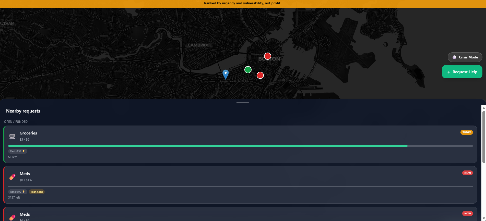
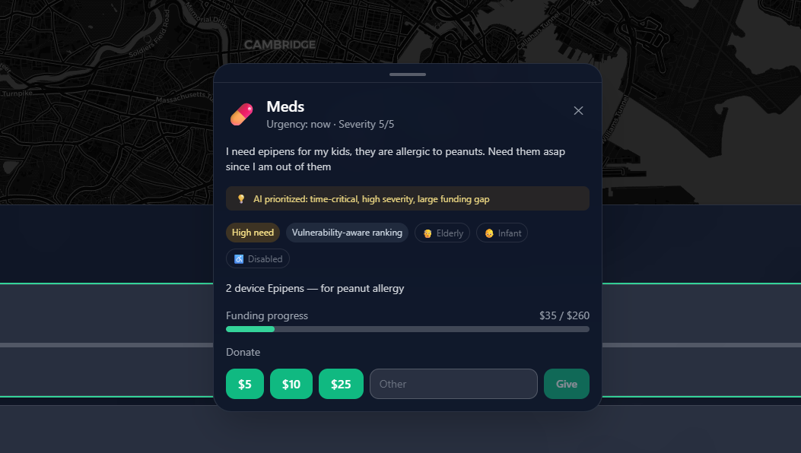
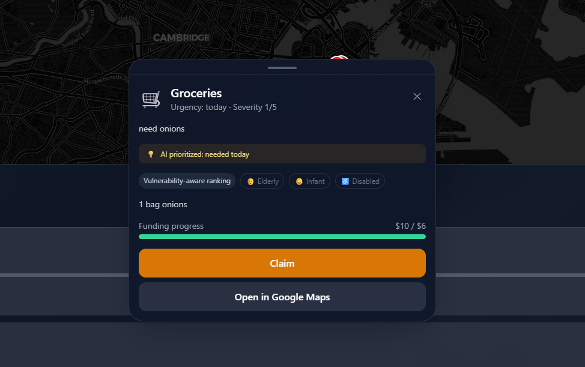
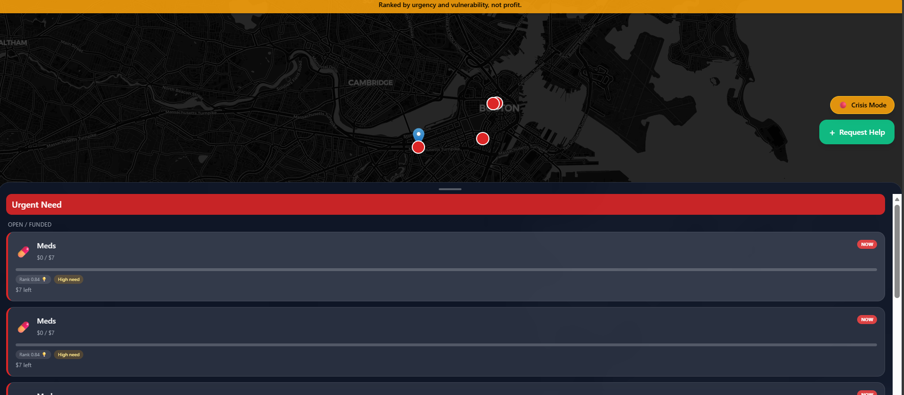

# RescueRun
AI-assisted mutual aid app for posting urgent needs, community funding, and helper delivery.

## Details
**What problem does this project solve?**  
RescueRun helps with local coordination during emergencies when people need medicine, food, shelter, or transport quickly. It converts messy text requests into structured tasks, prioritizes urgent ones, and lets the community fund and deliver help.

**Did you use any interesting libraries or services?**  
- FastAPI for backend APIs  
- MongoDB Atlas + PyMongo for persistence  
- Google Gemini API for AI intake parsing (with heuristic fallback)  
- React + Vite frontend  
- Leaflet / react-leaflet for map UX  
- Framer Motion + Tailwind CSS for interactive UI
- Rule-based triage scoring for prioritization

**What extension type(s) did you build?**  
Web app with:
- AI intake extension (`/v1/ai/invoke`) to structure requests from messy text  
- Ranking/triage extension (`/v1/ai/rank`) to prioritize requests by urgency, severity, and funding gap  
- Map-based coordination extension for donors and helpers
- Crisis-mode prioritization in frontend to surface only high-priority actionable tasks

**If given longer, what would be the next improvement you would make?**  
Add stronger trust and operations features: better ranking models, anti-fraud checks, helper ETA/routing, and offline-friendly support.

## Request Progress and Last Updated

Requests now show delivery status separately from their funding progress:

| Delivery stage | What it means |
| --- | --- |
| Posted | The request has been created. Its funding badge shows whether it is ready to claim. |
| Claimed | A helper has accepted the funded request. |
| On the way | The assigned helper has started the delivery. |
| Delivered | The helper has marked the delivery complete. |

### Using the tracker

1. Open a funded request and select **Claim**.
2. In **Delivery progress**, the assigned helper selects **Mark on the way**.
3. After delivery, that helper selects **Mark delivered**.
4. Expand **Status history** to see the recorded changes and their times.
5. Reopen completed requests from the sidebar's **Delivered** section.

Request cards, map popups, and details show **Last updated**, such as “3 minutes ago.” Hover over the time to see the exact timestamp in your local time zone. Cards refresh with the existing request polling; open details refresh every 10 seconds, and relative-time labels refresh every 30 seconds.

The update time changes on creation, funding activity, claiming, and delivery progress. Reading a request or recomputing its priority does not make it appear newly updated. Funding remains a separate progress bar. Crisis mode continues to show only high-priority requests that are open or funded.

### API and existing data

- `PATCH /v1/requests/{id}/status` accepts `{"status": "on_the_way"}` or `{"status": "delivered"}`.
- Use the existing `X-Device-Token` of the helper who claimed the request. The server enforces the order `claimed` → `on_the_way` → `delivered`.
- Repeating the same successful transition does not duplicate history or change its time.
- List responses include `created_at` and `updated_at`; details also include `status_history` and `is_claiming_helper`.
- The existing delivered endpoint uses the same transition rules: mark a request on the way before completing it.
- Existing requests work without a database migration. Missing historical transition times are labeled **Time not recorded**, rather than inferred from unrelated updates.
- Helper controls use the current browser's existing device token. Keep using that browser to manage its claimed deliveries; this extension does not add cross-device accounts.

### Tests

From the backend/project root:

```bash
python3 -m pip install -r requirements.txt -r requirements-dev.txt
python3 -m pytest tests -q
```

From `frontend/`:

```bash
npm ci
npm test
npm run build
```

The backend workflow tests use an in-memory MongoDB substitute and do not require Atlas or AI credentials.

## Set Up Instructions
### 1. Prerequisites
- Python 3.10+  
- Node.js 20+  
- MongoDB Atlas database  
- Gemini API key (optional, but recommended)

### 2. Backend setup
From project root:

```bash
pip install -r requirements.txt
```

Create `.env` in project root:

```env
DB_NAME=mutual_aid
MONGO_URI=mongodb+srv://<username>:<password>@cluster0.so1kl0s.mongodb.net/mutual_aid?retryWrites=true&w=majority&appName=Cluster0
GEMINI_API_KEY=<your_gemini_key>
GEMINI_MODEL=gemini-2.5-flash
```

Run backend:

```bash
uvicorn app.main:app --reload --port 8000
```

### 3. Frontend setup
From project root:

```bash
cd frontend
npm install
npm run dev
```

Open:
- Frontend: `http://localhost:5173`  
- Backend API: `http://localhost:8000`

### 4. Third-party registrations
- MongoDB Atlas account + cluster + DB user  
- Google AI Studio / Gemini API key

## Screenshots
### Map View


### AI Request Prioritization


### Claim Requests


### Crisis Mode


## Collaborators
- [Vaibhav Thalanki](https://github.com/Vaibhav-Thalanki)
- [Ackshay N R](https://github.com/Ackshay206)
- [Vinaya Rekha](https://github.com/avr5317)


